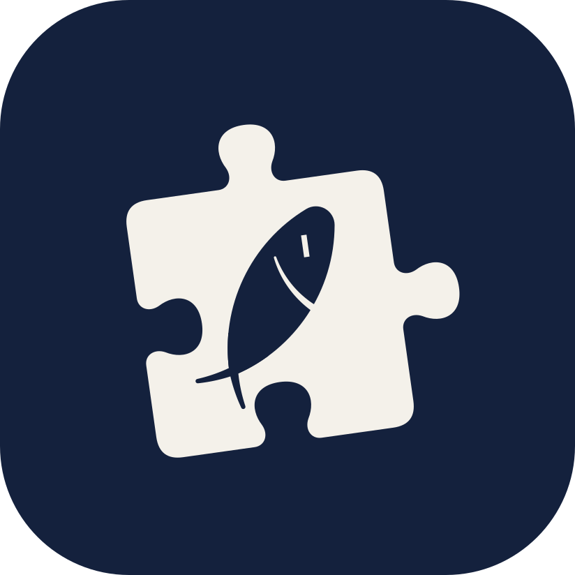
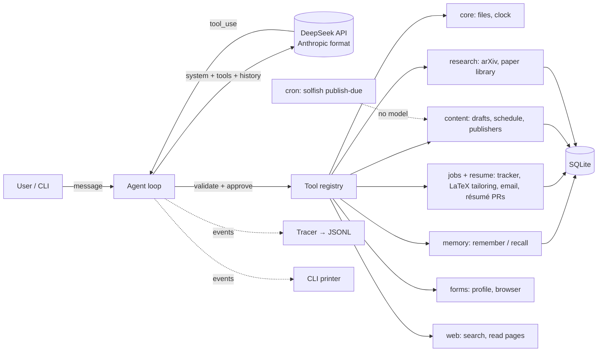

<p align="center">
  
</p>

<h1 align="center">Solfish</h1>

**Salt fish that solves and finishes.** A general-purpose personal agent, built from scratch on the Anthropic Messages API, running on DeepSeek by default.

Solfish is the agent I use day to day. Its core is a hand-written agent loop with no agent
framework: tool calling, approval gates, long-term memory, tracing and evals are all in this
repo, small enough to read in one sitting. Capabilities plug in as **skills**: web search and
reading, job search and résumé tailoring, social-media publishing, research (arXiv search, reading, a paper library),
and filling web forms from a personal profile.

> 中文简介：Solfish（salt fish 咸鱼，也是 solve and finish）是我自己从零写的通用个人 agent。不依赖 agent 框架，
> 核心循环、工具调用、记忆、追踪和评测都在这个仓库里。技能包括：联网搜索与读网页、求职与简历定制投递、
> 自媒体内容排期发布、科研（arXiv 检索、读论文、文献库）。

## What it looks like

<!-- TODO: replace with a real transcript or GIF from a live session -->
Illustrative session:

```text
you › I just applied to Acme for the AI Engineer role, and Globex invited me to an interview on Friday
💭 Two updates. Check the tracker first so I don't add duplicates.
→ list_applications {"status": "all"}
← #1 Globex | ML Engineer | applied | applied 2026-10-15
→ add_application {"company": "Acme", "role": "AI Engineer", "status": "applied"}
← Tracked #2: AI Engineer at Acme (applied).
→ update_application {"id": 1, "status": "interview", "note": "Interview on Friday"}
← Updated #1 (Globex): status applied -> interview.

🐟 Done: Acme is tracked as applied, and Globex has moved to interview (Friday is noted).

3 model calls, 3 tool calls | tokens in 412 (+5180 cached) out 236 | $0.0089
```

## Architecture



| Piece | File | What it shows |
|---|---|---|
| Agent loop | [`agent.py`](src/solfish/agent.py) | Every `stop_reason` handled (`tool_use`, `pause_turn`, `refusal`, `max_tokens`); step limit; append-only history |
| Tools | [`tools/`](src/solfish/tools/) | One Pydantic model per tool gives both the JSON Schema and input validation; failures go back to the model as `Error:` results |
| Skills | [`skills/`](src/solfish/skills/) | Tools + instructions bundled per capability; the core knows nothing about job hunting |
| Sessions | [`session.py`](src/solfish/session.py) | Conversations stored append-only and resumable; one manager runs turns for every channel and routes approvals from any of them |
| Web UI | [`server.py`](src/solfish/server.py), [`web/`](src/solfish/web/) | FastAPI + SSE + plain JS: live thinking and tool calls, approval buttons, workspace downloads; model output treated as hostile (no raw HTML, strict CSP) |
| Telegram | [`channels/telegram.py`](src/solfish/channels/telegram.py) | Long-polling bot on the raw Bot API: one live "working" message per turn, Allow/Deny buttons for approvals from any session, answers one chat id only |
| Spark | [`skills/spark.py`](src/solfish/skills/spark.py) | Solfish texts first, 5–8 random times a day: an interest, a goal check-in, a follow-up or how my day is going; backs off when ignored, never cuts into a chat |
| Memory | [`skills/memory.py`](src/solfish/skills/memory.py) | Persistent notes; recent ones in the system prompt, older ones searchable |
| Safety | `needs_approval` flag | Writes and deletes wait for a human `y` |
| Observability | [`trace.py`](src/solfish/trace.py) | JSONL trace per session: every model call, tool call, token count, cache hit and dollar cost |
| Evals | [`evals/`](evals/) | Task suite graded on *end state* (database rows, tools called), not on wording |

Design decisions and trade-offs are written up in [`docs/design.md`](docs/design.md).

## Quick start

Requires Python 3.11+ and a DeepSeek API key (`DEEPSEEK_API_KEY`). Solfish uses DeepSeek's
Anthropic-compatible endpoint, so switching back to Claude is only environment variables.
Copy `.env.example` to `.env`; it is read on startup, and variables set in the shell win.

```bash
python3 -m venv .venv && source .venv/bin/activate
pip install -e ".[dev]"

solfish                                    # chat
solfish ask "what applications are still active?"
solfish --skills core,memory               # load only some skills
solfish sessions                           # recent conversations
solfish spark                              # let Solfish pick a topic and start (/spark in Telegram)
solfish interests                          # what it knows you like talking about
solfish serve --open                       # local web UI at 127.0.0.1:8765 (pip install -e ".[server]")
                                           # + the Telegram bot, if SOLFISH_TELEGRAM_TOKEN is set
solfish --resume 20261101-152012-ab12cd    # pick one up where it stopped
solfish publish-due                        # publish scheduled posts that are due (run from cron)
solfish handoff 12                         # fill post 12 into 小红书 or 知乎; you press publish
solfish mark-published 12 https://...      # record a post you published yourself
```

Optional setup per skill (see `.env.example`):

- **resume**: `SOLFISH_RESUME_DIR` points at a LaTeX résumé repo; needs XeLaTeX. Email
  applications need the `SOLFISH_SMTP_*` settings. Changes to the master résumé are pushed as a
  `solfish/<name>` branch with the repo's own git credentials; `SOLFISH_GITHUB_TOKEN` (pull
  requests on that repo only) lets Solfish open the PR too.
- **content**: X needs the `SOLFISH_X_*` keys, and each post costs money. LinkedIn needs
  `SOLFISH_LINKEDIN_TOKEN`, renewed every 60 days. The blog needs the `SOLFISH_BLOG_*` settings.
  `solfish handoff` needs the same install as **forms**. Schedule publishing with cron, using the venv's full path; put
  the keys in `~/.solfish/.env`, which cron can find, e.g.
  `*/15 * * * * /path/to/Solfish/.venv/bin/solfish publish-due`.
- **web**: reading pages needs nothing. Search needs `SOLFISH_TAVILY_API_KEY` (free key at
  [tavily.com](https://tavily.com), 1,000 searches a month) or `SOLFISH_SEARXNG_URL`, a SearXNG
  you host yourself with the JSON format enabled.
- **reading**: `SOLFISH_READING_TOKEN` (from `npm run reading:token` in the site repo) lets
  Solfish post the reading notes it helped write; listing the shelf needs nothing.
- **research**: nothing; arXiv needs no key.
- **forms**: `pip install -e ".[forms]" && playwright install chromium`. Put sensitive details
  in the profile from the terminal, so they never reach the model:
  `solfish profile set passport_no --sensitive` (`solfish profile list` to check).

Data lives in `~/.solfish/` (SQLite database, workspace, traces) and never enters the repo.

## Tests and evals

```bash
pytest                        # offline: the agent loop runs against a scripted fake client
ruff check .
python evals/run_evals.py     # live: runs the task suite against the real API (costs money)
```

Unit tests cover the loop's control flow: parallel tool calls, bad arguments, declined
approvals, step limits, refusals, interrupted turns, and that history stays append-only.
The eval suite measures what the tests can't: whether the model, given these prompts and
tools, actually does the right thing.

## Running it on a server

Telegram uses long polling, so a small VPS with no open ports beyond SSH is enough (1 GB RAM;
Ubuntu 24.04 with `git sqlite3 python3.12-venv rsync`). [`deploy/`](deploy/) has the pieces:

```bash
SOLFISH_DEPLOY_HOST=user@host deploy/deploy.sh          # push code, install, (re)start the service
SOLFISH_DEPLOY_HOST=user@host deploy/deploy.sh logs     # follow the log
SOLFISH_DEPLOY_HOST=user@host deploy/deploy.sh backup   # copy the newest daily snapshot to the Mac
```

The first time, copy `~/.solfish/` (without `browser/`) and `.env` into `~/.solfish/` on the
server, `chmod 600` them, and stop any bot on the laptop: two bots on one token steal each
other's updates. The server then holds the only copy of the data; a timer snapshots the database
at 04:00 and keeps 14 days. The web UI stays on the server's 127.0.0.1; reach it with
`ssh -L 8765:127.0.0.1:8765 user@host`. Skills that open a browser (forms, 小红书/知乎 handoff)
still need the Mac.

## Roadmap

- [x] Agent loop, tool registry, approval gate, tracing
- [x] Skills: core (files, clock), memory, jobs (application tracker)
- [x] Offline tests and live eval suite
- [x] resume: tailor my LaTeX résumé to a JD, build the PDF (one-page check), apply by email
- [x] resume: keep the master résumé current through pull requests I review and merge
- [x] content: per-platform drafts, scheduling, outbox publisher, `publish-due` for cron
- [x] research: arXiv search, paged full-text reading, paper library with notes
- [x] web: search (Tavily or self-hosted SearXNG) and paged reading of public pages
- [x] forms: fill web forms from my profile in a visible browser; secrets stay local, clicks through
  multi-step forms, never submits
- [x] content: X and LinkedIn publishers; blog drafts; 小红书 and 知乎 handoff (fills the page, I
  press publish)
- [x] reading: check what I learned from a book, then post it as a reading note on my site
- [ ] content: 公众号 drafts through the official API
- [ ] research: run experiments in a sandbox (code execution) and log results
- [ ] jobs: interview prep from a JD + my past notes
- [ ] travel: city trip planning: research travel guides, book tickets (with approval), build a day-by-day itinerary
- [ ] MCP client: load tools from any MCP server as a skill
- [ ] Context management for long sessions (compaction)
- [x] Sessions: stored, resumable conversations; approvals any channel can answer
- [x] Local web UI (live tool calls over SSE, approval buttons, workspace downloads)
- [ ] Streaming replies in the web UI
- [x] Telegram front end, so it's reachable from my phone
- [ ] macOS menu bar app with a quick-ask hotkey
- [ ] Scheduled runs (morning brief: deadlines, follow-ups)
- [x] spark: Solfish starts conversations from my interests (`/spark`, `solfish spark`)
- [x] spark: random sparks through the day (interests, goals, follow-ups, check-ins) with
  back-off; friend-like conversation style
- [ ] spark: news, papers and project activity as material; learn which sparks I answer

## License

MIT
